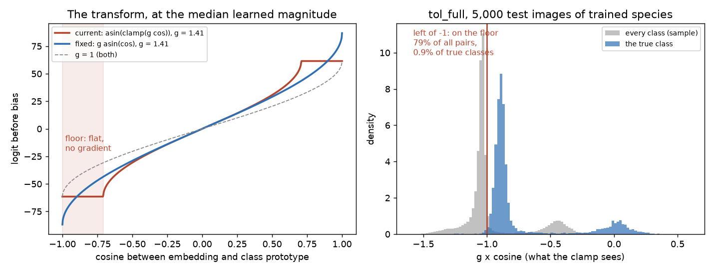

# Does the cosine head's clamp floor cost accuracy, and does the fix train as well?

**Kind:** research · **Status:** OPEN (2026-11-19). The defect measured at 190 k classes (`dev/113`); the fix
built in mini_trainer (mt, 1554c9c, CPU test passed); its tests (CF, and a 190 k-class head check) submitting, before any longer ToL training. Found at Lepidoptera scale by the
mt session on 2026-11-03 ([[2026-11-03-moving-the-recipe-into-mini-trainer]]); the floor itself was first seen in
August ([[2026-08-06-the-cosine-head-is-not-unit-norm]]).

## The problem, in plain words

The head scores an image against each species with a **cosine**: the agreement between the image's direction and
the species' direction, from +1 (same) to -1 (opposite). The cosine is then stretched into a score (the logit) by
`asin` and a factor sqrt(D-2) = 39.2 for D = 1,536, and the softmax turns the scores into probabilities. `asin` only
accepts inputs between -1 and +1.

The recipe adds a learned **magnitude** per species, `g`, and multiplies the cosine by it *before* the stretch:
`logit = 39.2 * asin(clamp(g * cos, -1, 1)) + b`. Once `g` is above 1, `g * cos` can leave [-1, 1], so the code clamps
it. Every species with `g * cos` below -1 gets the same minimum score (-61.6 plus its bias), whatever its cosine:
that is the **floor**. On the floor the score is flat, so its slope is zero, and training learns through slopes. A
species on the floor sends no "move closer" or "move away" signal to the image, and receives none.

For wrong species that is harmless, and the network uses it on purpose: growing `g` is an easy way to give most
wrong species the lowest possible score. On tol_full, `g` grew to 1.41 (median; it starts at 1), so any cosine below
-0.71 is floored. That is 79 % of all (image, species) pairs, and the median image has about 790 species off the
floor out of 190,199, a learned shortlist.

The defect is when the **true** species is on the floor. The loss wants its score raised, but the slope is zero, so
neither the image's embedding nor the species' prototype moves towards the other; only the species' bias rises, which
raises it for every image. That image stays wrong unless something else moves it.

Left: the score against the cosine at g = 1.41. The current head (red) is flat below -0.71; the fix (blue) is not.
At g = 1 both are the grey curve. Right: `g * cos` for 5,000 test images. Wrong species pile up just left of -1 and
true species just right of it, so the head separates them at the clamp's edge.

## Measured (`dev/113 stats`, fp32 head maths, 19,992 test images of trained species)

| checkpoint | g median | pairs on the floor | true class on the floor | top-1 | errors with the true class on the floor |
|---|---|---|---|---|---|
| ToL pilot (one pass) | 1.17 | 0 % | 0 % | 35.0 % | 0 % |
| tol_full (five passes) | 1.41 | 78.4 % | **0.88 %** | 81.3 % | **4.7 %** |
| Lepidoptera, B0 F / BU / V2-S F (mt, 2026-11-03) | 1.72 / 1.54 / 1.74 | 94 / 97 / 57 % | 0.33 / 0.31 / 0.09 % | | about 4 % (B0 F) |

The floor grows as `g` grows during training, and the stranded share grows with the number of classes. Every image
with its true class on the floor is misclassified, so the ceiling on what the fix can recover is 0.9 points of top-1
at 190 k classes (less in practice: some of those images would be wrong anyway).

The gradient, checked on one toy image (`dev/113 grad`; target at cos -0.80, two competitors at -0.45 and -0.50,
g = 1.5): the current head gives the target's cosine a gradient of exactly 0 (competitors +78.4 and +1.3); the fixed
head gives -97.9 (competitors +63.5 and +2.3). At g = 1 both forms give identical scores.

## The fix

Apply the magnitude after the stretch: `logit = g * 39.2 * asin(clamp(cos, -1, 1)) + b`. The cosine of two unit
vectors is always in [-1, 1], so the clamp becomes a guard against rounding only, every species keeps a slope, and
`g` becomes a per-species temperature. It is the mt session's "scale on z" from 2026-11-03, opt-in in mini_trainer so
no published number moves.

**What it could break.** The current head discriminates *at* the floor's edge (figure, right). The fixed head has
no floor to use, so it must separate species on `asin`'s steep part near -1 instead. That is a different solution,
not a corner fixed, and it may train worse. `asin`'s slope also grows without bound near +/-1 (capped at about 2,200
by the rounding guard), which can make large gradients for an image almost opposite its own species; the recipe's
gradient clipping (norm 5) bounds them. Alternatives if it fails: `g` frozen at 1 (mini_trainer's documented
default), or a clamp that passes the gradient through.

## The test (CF), before any longer ToL run

The pilot cannot test it: after one pass nothing is on the floor. The floor exists in trained Lepidoptera heads, and
three seeds give a noise band, so:

- **CF**: V2-S BU with the fix, otherwise exactly v2s_bu_s42, against v2s_bu_s42/43/44 (test fold species macro-F1
  seed range about 0.11 points). The three seeds ran on 5 Nov code, so the same job also reruns v2s_bu_s42 on today's
  code without the fix (mt's suggestion): CF is one factor from that control, and the control against the old s42
  shows whether the code moved anything. Built by mt as the opt-in head option `magnitude_after_angle` (default
  unchanged); its CPU test reproduces the gradients above (zero for a floored target before, non-zero after),
  identical logits at g = 1, and the option surviving a save and reload.
- **Predictions (2026-11-19, before any run):** nothing on the floor by construction; test fold within the seed range
  or up to 0.3 above (the stranded share, 0.1-0.3 % of images at Lepidoptera scale, bounds the gain); traps not below the seeds. If
  CF is below the range on the test fold, the floor is doing useful work and the next ToL run keeps the current head.
- **The 190 k-class check** (mt's design, about 2-3 B200-hours): the V2-S run cannot show the floor at ToL scale, so
  two head-only arms on tol_full's frozen trunk, both starting from its trained head (78 % of pairs on the floor), one
  with the current head and one with the fix, each trained for one pass of the pilot set. The two forms give
  different logits at the same parameters when g is not 1, so the fixed arm starts perturbed (a floored pair at cos
  -0.8 moves from -61.6 to about -51; a true class at cos 0.5 from 30.7 to about 28.9): this tests how training
  proceeds from there, not a drop-in swap.
- **Predictions for the 190 k check (supervisor, 2026-11-19, before it runs):** (a) the current arm keeps its floor
  (pairs and stranded targets within 0.2 points of 78.4 % and 0.88 %); (b) the fixed arm's top-1 on the known test
  images ends within 1 point of the current arm's, either way; (c) on the images whose true class started on the
  floor, the fixed arm gets at least 10 points more of them right than the current arm. If (b) fails by more than a
  point downward, the floor does useful work at 190 k classes and the next ToL run keeps the current head whatever
  CF says; if (c) fails, the stranded images are wrong for reasons the floor does not explain.
