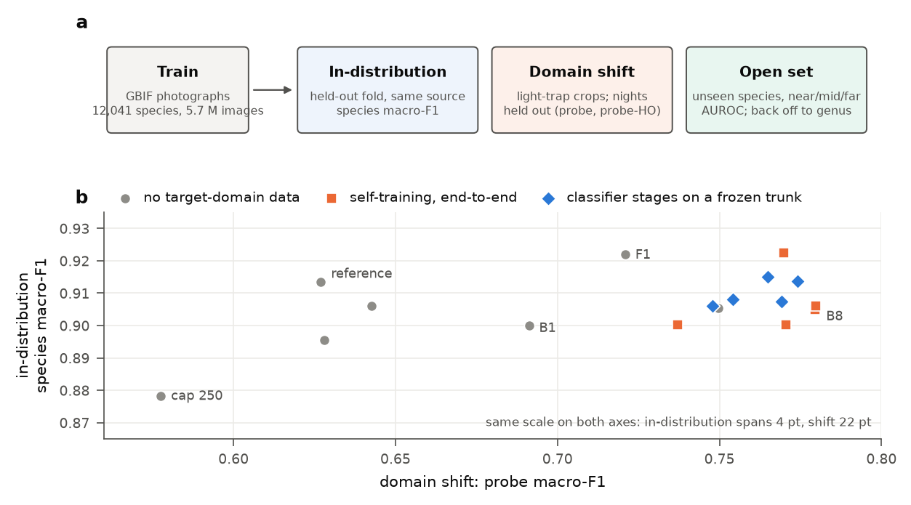
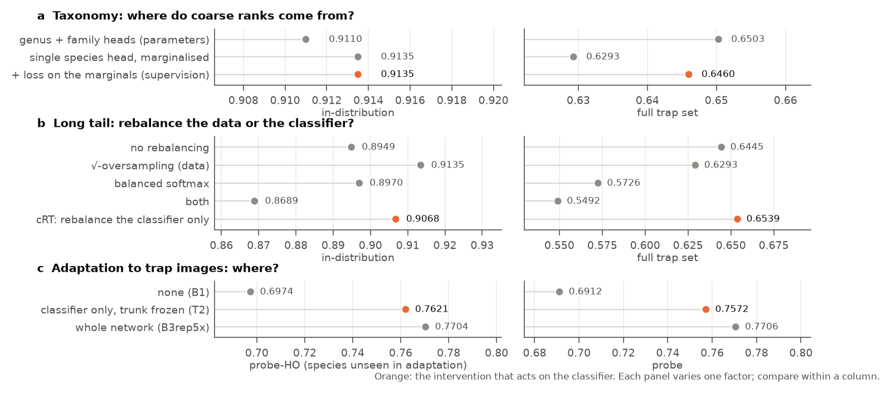
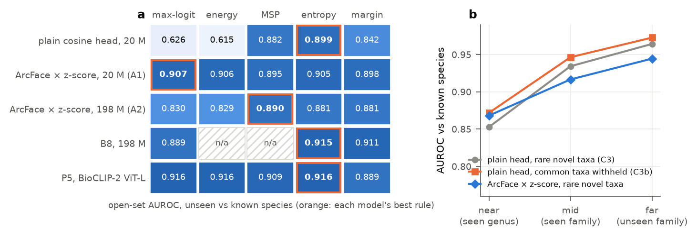
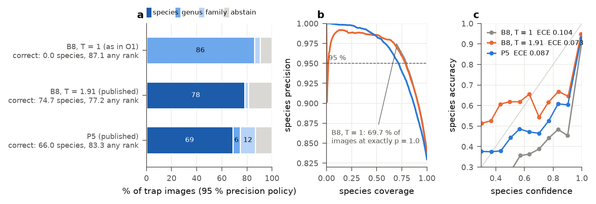
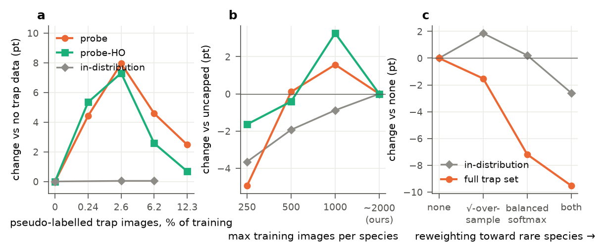
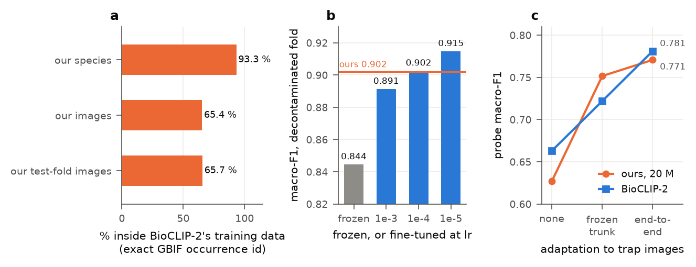

# Knowing what you don't know: calibrated open-set hierarchical classification for long-tailed species identification

**Status:** working draft (2026-10-21). Numbers are from `RESULTS.md`, reasoning in
[`../journal/`](../journal/). Figures from `dev/074_figures.py` (Figure 4 from
`dev/086_deployment_gap.py`). Remaining owner tasks are in `PLAN.md` §1.
---

## Abstract (draft)

Species identification is usually framed as fine-grained classification over a fixed label set. We
argue this is wrong for deployment, on a 12,041-species Lepidoptera benchmark scored on three axes: a
held-out fold, an external camera-trap source, and open-set detection of unseen taxa. First,
**hierarchical prediction heads do not help**: multi-head, parent-conditioned and autoregressive
heads are matched or beaten by a *single* species head whose coarse ranks come from marginalising its
posterior. Coarse **parameters** hurt; coarse **supervision** helps, visibly only off the training
distribution. Second, in-distribution accuracy is near saturation (0.9316) yet falls to **0.69 on
data from a different source**, and choices made on the first axis invert on the others. Long-tail
methods degrade cross-source accuracy **monotonically in how hard they reweight the tail** (a
9.5-point spread the in-distribution column does not order), and the best open-set scoring rule
changes with model capacity, a 6–7.6 point effect that inverted a published ranking of our own. A
held-out fold of the training distribution sees neither inversion. Third, **unlabelled** target
images are the strongest lever we find. Self-training gains 7.9 points on held-out trap nights
without a single target label (89 % of what hand-labelling the same images buys, and unlike hand
labels at that dose it keeps its gain on species nobody labelled), costs nothing in-distribution, and
lets a 20 M model beat a 198 M one, with a sharp optimum in the *share* of target data beyond which
adaptation becomes memorisation. An **angular margin composed with a dimension-aware z-score
transform** relocates novelty signal more than it improves it: +0.78 AUROC (0.8990 → **0.9068**) for
1.00 point of accuracy, but the spread across scoring rules collapses from 28.4 points to 1.2, and
class centroids can replace the classifier matrix at inference (0.29 points, against 3.7 without the
margin). Finally, **two thirds of our held-out test fold, 413,865 images, lie inside a biological
foundation model's training set by exact occurrence identifier**, which a check by species name
misses. On a decontaminated fold that model, fine-tuned, is the better representation, a *frozen*
probe understates it by 7 points, and with our adaptation recipe applied to each, the two converge.
Our contribution is the recipe, not the encoder, and the ceiling is set by target-domain data. We
release the package, models and reproduction recipes.

---

## 1. Introduction _(outline)_

**Figure 1.** **(a)** Every model is scored on three axes: a held-out fold of the training source,
light-trap images from whole nights never used for adaptation, and species never trained on.
**(b)** In-distribution against domain-shift accuracy for 17 models, at the same scale on both axes.
In-distribution macro-F1 spans 4 points and orders the models poorly; under shift they spread over
22 points, and what separates them is whether, and how, target-domain images were used.

- Species ID from images is fine-grained, long-tailed (53 % of species have < 200 images), and
  **open-set in deployment**: a field tool constantly meets taxa outside its label set.
- The literature encodes the taxonomy in the *architecture* (hierarchical softmax, conditional heads,
  autoregressive decoders). We find it does not pay.
- Reframe: the taxonomy's value is in **abstention and novelty handling**. Two kinds of "unknown":
  1. **Image-space / open-set**: the taxon was never trained on. Detect it.
  2. **Hierarchy-space / rank abstention**: the photo cannot resolve the species. Back off to the
     rank the evidence supports ("unknown species, but *Noctuidae*").
- Contributions:
  - **(C1)** hierarchical heads do not help; coarse *parameters* hurt, coarse *supervision* helps,
    and only the first is visible in-distribution (§4.1);
  - **(C2)** **interventions belong in the classifier, not the representation**: coarse supervision,
    long-tail rebalancing, domain adaptation and the prototype matrix all resolve that way (§4.15).
    This is the spine;
  - **(C3)** **unlabelled target-domain data is the strongest, cheapest lever**, with a sharp optimum
    in its *share* beyond which adaptation becomes memorisation (§4.11);
  - **(C4)** **the long-tail ranking inverts under source shift**, monotonically in how hard a method
    reweights the tail, and the trade comes from *where* rebalancing is applied (§4.13);
  - **(C5)** **benchmark contamination and a cheap test for it**: two thirds of our test fold is in a
    foundation model's training set, and a frozen probe understates that model by 7 points (§4.14);
  - **(C6)** **ArcFace × z-score**: why they compose, and that the margin *relocates* open-set signal
    rather than creating it (§2.3, §4.3);
  - **(C7)** 17 % of the generalisation gap is removable by naming nuisances (§4.8);
  - **(C8)** a margin degrades *marginalisation* more than classification, through calibration, at
    two scales (§4.7);
  - **(C9)** an open, reproducible package, with every negative result recorded.

## 1b. Related work _(drafted from memory — every citation marked [VERIFY] needs checking against the source before submission; author lists, years and venues are not reliable)_

**Cosine classifiers and angular margins.** Normalised-prototype classifiers and additive angular
margins are standard in face recognition (SphereFace, CosFace, ArcFace [Deng et al., CVPR 2019,
VERIFY]), where the goal is an embedding whose *distances* are meaningful. NormFace [Wang et al., ACM
MM 2017, VERIFY] gives the scale-factor lower bound we use in §2.3. Our contribution is the margin's
**composition with a dimension-aware calibration**: on raw cosines the margin costs 3.3 points of
accuracy for AUROC 0.732; composed with the z-score transform it costs 0.4 for 0.9115. We know of no
prior report that the margin's accuracy/open-set trade-off depends on the scale it is applied on.

**Hierarchical classification.** The literature encodes the taxonomy in the architecture:
hierarchical softmax, conditional/parent-gated heads, autoregressive decoders over the label path
[VERIFY: representative citations needed]. It evaluates in-distribution throughout, to our knowledge,
so the split between coarse parameters and coarse supervision (§4.1) does not appear there.

**Long-tailed recognition.** Square-root resampling [Mahajan et al., ECCV 2018, VERIFY], logit
adjustment [Menon et al., ICLR 2021, VERIFY], Balanced Softmax [Ren et al., NeurIPS 2020, VERIFY],
LDAM [Cao et al., NeurIPS 2019, VERIFY], class-balanced reweighting by effective number [Cui et al.,
CVPR 2019, VERIFY] and decoupling/τ-normalisation [Kang et al., ICLR 2020, VERIFY]. These methods are
benchmarked on in-distribution splits (CIFAR-LT, ImageNet-LT, iNaturalist) essentially without
exception. Our contribution is the **evaluation axis**: their ranking inverts under source shift
(§4.13).

**Open-set recognition and OOD detection.** Max-softmax-probability [Hendrycks & Gimpel, ICLR 2017,
VERIFY], energy scores [Liu et al., NeurIPS 2020, VERIFY], and the max-logit family. We have not seen
it reported that the best of these changes with model capacity and with the head's output convention
(§4.9).

**Domain adaptation and self-training.** Pseudo-labelling with confidence thresholds is long
established [Lee, ICML workshop 2013, VERIFY], with FixMatch and noisy-student as modern
representatives [Sohn et al. 2020; Xie et al. 2020, VERIFY]. The usual concern is label noise. A
sharp interior optimum in the *share* of target data, with transfer to unseen classes falling as that
share rises (§4.11), is to our knowledge not documented.

**Biological foundation models, and benchmark contamination.** BioCLIP and BioCLIP-2 [Stevens et al.,
CVPR 2024; 2025, VERIFY] train CLIP-style encoders on TreeOfLife-10M/200M, assembled largely from
GBIF, iNaturalist and EOL. Such models are usually evaluated on a downstream taxonomic benchmark with
a frozen linear probe. Both halves of that protocol fail here (§4.14): the benchmark overlaps the
pretraining corpus by exact occurrence identifier, which taxonomic overlap checks cannot see, and the
frozen probe understates the representation. Contamination audits of this kind are routine in NLP
[Dodge et al., EMNLP 2021, VERIFY] and, as far as we know, not yet here.

**Calibration.** Temperature scaling [Guo et al., ICML 2017, VERIFY]. Marginalisation makes
calibration *load-bearing* (§4.7): summing a poorly calibrated posterior gives a wrong parent even
when the top-1 is right.

## 2. Method

### 2.1 Cosine classification head

A backbone $f_\theta$ maps an image to $z \in \mathbb{R}^{d}$ through a bottleneck, then
$e = z/\|z\|$. Each class $j$ owns a prototype $w_j$ constrained to $\|w_j\| = 1$
(weight-norm with the row norm frozen), so the pre-activation is a cosine similarity

$$
\cos\theta_j  =  e^{\top} w_j  \in  [-1, 1].
$$

### 2.2 The z-score transform (and why a raw cosine is a poor logit)

In high dimension the cosine between (near-)random unit vectors concentrates sharply: for $e$
uniform on $S^{d-1}$, $\cos\theta$ has mean 0 and standard deviation $1/\sqrt{d}$, so with
$d = 1280$ virtually all class scores fall inside a band of width $\approx 0.1$. A softmax over that
is nearly uniform whatever the embedding's quality, which is why cosine classifiers need a scale
factor.

Instead of an arbitrary multiplier we apply the transform that maps this distribution onto an
approximately standard normal one:

$$
Z(\cos\theta)  =  \sqrt{d-2} \Bigl(\arccos(-\cos\theta) - \tfrac{\pi}{2}\Bigr).
$$

Its derivative at $\cos\theta = 0$ is $\sqrt{d-2}$: the transform *is* a scale, but a dimension-aware
one rather than a tuned constant. Logits are $Z(\cos\theta_j) + b_j$ with $b_j$ frozen at 0.

*Implementation note.* $Z$ is defined on $[-1,1]$ and implemented with a clamp. Prototype rows are
constrained to unit norm, but in trained checkpoints they drift (mean norm 1.08 for the margin head,
1.77 without it), so some pre-activations fall outside $[-1,1]$ and saturate. **No image has two
saturated logits**, so the prediction is never affected; the top-1 saturates on **0.37 %** of images
for the margin head and none for the plain one. Accuracy results are exact; the calibration argument
of this section carries that 0.37 % exception.

### 2.3 ArcFace × z-score

ArcFace [Deng et al. 2019] sharpens class boundaries by rotating the *true* class by a margin $m$
before the softmax, $\cos\theta_y \mapsto \cos(\theta_y + m)$, and rescaling by a constant $s$:
$\ell_j = s\cos\theta_j$ for $j \ne y$, $\ell_y = s\cos(\theta_y + m)$.

We instead **compose the margin with the z-score transform**:

$$
\ell_j  =  \begin{cases} Z\bigl(\cos(\theta_y + m)\bigr) & j = y \\ Z(\cos\theta_j) & j \ne y \end{cases}
$$

with the margin applied **only during training** (at inference $m = 0$, so the forward pass is
label-free and exports to ONNX unchanged).

Two implementation notes:

1. **The head stays label-free.** $Z$ is *invertible*,
   $\cos\theta = \sin\bigl(Z/\sqrt{d-2}\bigr)$ (verified to $10^{-7}$), so the head emits
   $Z(\cos\theta)$ and the **loss** recovers the cosine, rotates the true class, and re-applies $Z$.
2. **No $s$ to tune.** For the softmax to express confidence $p$ over $C$ classes it needs
   $s \gtrsim \log\bigl((C-1)p/(1-p)\bigr)$ [Wang et al. 2017]; at $C = 12{,}041$, $p = 0.9$ that is
   $s \ge 11.6$. The z-score's implicit scale is $\sqrt{d-2} = 35.7$ at $d = 1280$, **already above
   the floor**. The transform supplies the scale that raw-cosine ArcFace must guess.

### 2.4 Marginalisation instead of coarse heads

Let $\pi(\cdot)$ map a class to its parent. Coarse posteriors come from the species posterior rather
than from dedicated heads:

$$
\log P(g)  =  \mathrm{logsumexp}_{\{ s : \pi(s)=g \}} \log P(s),
$$

applied recursively up the taxonomy. This is exact, adds no parameters, and makes the levels
**probabilistically coherent**: the coarse posterior *is* the sum of the fine one. Independent
per-level heads have no such relation; they contradict each other's argmax on 1.81 % of images.

Rank abstention (§4.6) compares $P(\mathrm{genus})$ against $P(\mathrm{species})$, which is only
meaningful within one distribution. Coherence does **not** imply argmax agreement: $\max$ and $\sum$
do not commute over a partition, so a confident species can be outvoted by many diffuse siblings of
another genus. The coarse answer is then arguably the better one, since aggregating sibling evidence
is what the marginal is for.

## 3. Experimental setup

12,041 species / 4,333 genera / 102 families; 5.04 M training images (6.33 M before the 50-image floor and the validation and test folds); a held-out fold of
**629,742 images**. Backbone efficientnet\_v2\_s unless stated; Muon + AdamW, one-cycle, 5 epochs,
460→256 px, square-root class oversampling ($p=0.5$). Metric: **species macro-F1** (each species
weighted equally, so the tail counts). All comparisons change exactly one factor; configs are
released. Open-set benchmark: species with < 50 images, excluded from training but drawn from the
**same image distribution**, isolating novelty from domain shift.

### 3.1 How the baseline recipe was chosen

The baseline was not designed. It was built by single-factor ablation from a weak start, and the
order of what mattered is informative.

| change | species macro-F1 | Δ |
|---|---|---|
| Muon + flat-cosine schedule, heavy augmentation | 0.8297 | — |
| + warmup, **lighter** augmentation, looser gradient clip | 0.8769 | +4.7 |
| flat-cosine → **one-cycle** schedule | 0.8887 | +1.2 |
| 5 → 10 epochs | 0.8976 | +0.9 |
| 5 epochs + **square-root class oversampling** | **0.9148** | +2.6 |

**The optimiser was not the lever.** Muon is in every row. The schedule, augmentation strength and
sampler moved the number. Under a flat schedule the model was still descending when the budget ran
out; one-cycle fixed that.

**Square-root oversampling beats logit adjustment on structural grounds.** Logit adjustment reached
0.9031 and *degraded* genus and family. Its single temperature $\tau$ is shared across three label
distributions with very different class counts and tails (12,041 / 4,333 / 102), and no single value
suits all of them. Oversampling changes which examples are drawn, not what the loss means, so it acts
consistently at every level. The same argument favours marginalisation over per-level heads (§2.4):
**in a hierarchy, prefer mechanisms that do not need one constant to be right at every level at
once.**

**Numerics.** Runs use fp16 autocast with **the head forced to fp32 inside an adapter**. Without it
the head overflows; an autoregressive baseline trained visibly broken until its precision was
changed, a numerical failure that looks like a modelling bug. ArcFace with a positive margin is
fp16-unstable even with the adapter ($s\cos\theta$ overflows and $\arccos$ returns NaN), so **every
margin run uses bf16** and the configuration layer warns on the unsafe combination.

Two caveats. The +4.7 row bundles three changes, so their individual contributions are
unrecoverable. The 10-epoch run was still improving, so the 5-epoch budget of §4 is a comparison
convention, not a converged optimum: absolute numbers understate what the architecture can reach,
while the *differences* between arms are measured at matched budget.

### 3.2 Four benchmarks, and why they are not interchangeable

The evaluation sets answer different questions, and **differences are only meaningful within a
column.**

| name | images | species | what it is |
|---|---|---|---|
| **in-distribution** | 629,742 | 12,041 | held-out fold of the training distribution |
| **full trap** | 47,905 | 486 | every camera-trap image. *Contaminated for anything trained on trap data* |
| **probe** | 15,200 | 368 | whole (trap, night) capture groups held out of adaptation. The honest shifted column |
| **probe held-out species** | 2,455 | 58 | probe restricted to species adaptation never saw. Separates domain adaptation from specialisation on the adapted taxa |
| **open-set** | 3,000 | 566 unseen | novel species drawn from the *same* image distribution, isolating novelty from shift |

**Macro-F1 does not decompose over subsets, so two benchmarks over the same images can rank two
models oppositely with both results correct.** One model ties another on all 47,905 trap images
(+0.0002) and beats it by **2.03 points** on a 15,200-image *subset*, because the full set averages
over 486 species at $1/486$ each and the subset over 368 at $1/368$. This holds for any per-class
average, so we never quote a difference computed across two evaluation sets.

**A benchmark's exclusivity has to be recorded in the split.** The trap corpus was both our external
benchmark and our only unlabelled target data, so self-training would have trained on its own test
set. The grouped (trap, night) partition makes that conflict structural. §4.14 reports the same
failure one level up, with somebody else's pretraining.

## 4. Results

### 4.0 Summary of models

Models referred to repeatedly (each section varies one factor):

| model | what it is | in-dist | probe | probe-HO | open-set | species / any rank, 95 % policy |
|---|---|---|---|---|---|---|
| baseline | effnetv2_s, single head + marginals, √-oversampling | 0.9135 | 0.6270 | 0.6412 | 0.8990 | — |
| A1 | baseline + ArcFace × z-score | 0.9035 | 0.6437 | — | 0.9068 | — |
| best in-distribution | ConvNeXtV2-L @320, multi-head | **0.9316** | — | — | — | — |
| **B8** (ours) | 198 M, no √-oversampling, self-training at the 2.6 % dose, T = 1.91 | 0.9060 | **0.7798** | 0.7816 | 0.9153 | **74.7 %** / 77.2 % |
| **P5** | BioCLIP-2 fine-tuned + unfrozen adaptation | 0.9113 | 0.7757 | 0.7817 | **0.9161** | 67.4 % / **86.4 %** |
| shippable student | fastvit_sa12, distilled | 0.8967 | — | — | — | — |

**B8 and P5 tie on accuracy** (§4.14.4; P5 probe/held-out are means of two draws, spread 0.0107 and
0.0021) and trade off under abstention (§4.6a). Open-set AUROC is each model's *best* scoring rule
(§4.9). The last column is the share of held-out trap images answered correctly at species, and at
any rank, under a 95 %-precision back-off policy fitted on the other half of the trap nights.

### 4.1 Hierarchical heads: what the taxonomy should and should not touch (C1, C2)

**Figure 2.** Three questions about where an intervention should act, each on the same backbone with
one factor varied. **(a)** Coarse ranks: separate genus and family heads (coarse parameters) against
one species head marginalised, with and without a loss on the marginals (coarse supervision).
**(b)** The long tail: rebalancing the training data against rebalancing only the classifier (cRT).
**(c)** Adaptation to trap images: none, the classifier alone on a frozen trunk, or the whole
network. In each, the classifier-side intervention (orange) keeps in-distribution accuracy and holds
up under shift (§4.15).

Four ways of getting a label at every level, sharing the same backbone, bottleneck and cosine
prototypes, differing only in how the taxonomy enters. Fine = species (12,041 classes); coarse =
genus (4,333) and family (102).

| head | coarse **parameters** | coarse **supervision** | information flow |
|---|---|---|---|
| multi-head independent | yes, one layer per level | yes, one CE per level | none between levels |
| parent-conditioned ("conditional") | yes | yes | **top-down**: parent conditions child |
| autoregressive | yes (decoder) | yes | top-down, sequential |
| single head + marginal *inference* | **no** | **no** | bottom-up, at test time only |
| single head + marginal *supervision* | **no** | yes | **bottom-up**, during training |

The parent-conditioned head corrects each level's independent logits $M^{(i)}$ by the parent's
already-conditioned score, so a child cannot be more confident than its parent's evidence allows:

$$
C^{(\text{top})} = M^{(\text{top})}, \qquad
C^{(i)} = M^{(i)} + \mathrm{gather}_{\pi}\Bigl(C^{(i+1)} - \mathrm{logsumexp}_{\text{siblings}} M^{(i)}\Bigr)
$$

i.e. $P_{\text{cond}}(\text{child}) = P(\text{child}) \cdot P_{\text{cond}}(\text{parent}) / P(\text{siblings})$ in log-space. Marginalisation (§2.4) is the mirror: information flows
*up*, and no coarse parameters exist.

| head | species | genus | family | **external (shifted)** |
|---|---|---|---|---|
| multi-head independent | 0.9110 | 0.9587 | 0.9708 | **0.6503** |
| parent-conditioned | 0.8845 | 0.9471 | 0.9683 | 0.6213 |
| autoregressive | 0.69–0.73 | — | — | — |
| single head + marginal inference | **0.9135** | 0.9606 | 0.9739 | 0.6293 |
| single head + marginal supervision | **0.9135** | **0.9633** | **0.9778** | 0.6434 |

Run-to-run spread, from retraining one configuration unchanged: **0.0000** species, 0.0005 genus,
0.0024 family, **0.0069** external.

**Coarse *parameters* do not help.** Every head with genus/family layers is beaten in-distribution by
one without. Conditioning is worse still (−2.9 pp species) **and worst under shift** (0.6213): it
propagates the parent's errors downward, and shift degrades the parent too.

**Coarse *supervision* helps, where in-distribution accuracy cannot see it.** The marginal losses
leave species **exactly unchanged** (0.9135, four decimals) and lift genus by 0.27 pp, acting only on
how mass is spread within a parent. Under shift the same change is worth **+1.41 pp**.

**The two questions have opposite answers, and the standard protocol sees only one.** Dropping coarse
parameters is right (+0.25 pp in-distribution, smaller, coherent); dropping coarse supervision is
wrong (−2.10 pp externally, 3× the noise floor). A held-out fold of the training distribution, the
norm in this literature, sees only the first. Marginal supervision keeps the parameter saving and
lands within one noise floor of the multi-head under shift; the residual 0.69 pp is below what our
replication can resolve.

### 4.2 Accuracy saturates; generalisation does not (C4)

| model | in-distribution | external dataset |
|---|---|---|
| efficientnet\_v2\_s | 0.9110 | — |
| ConvNeXtV2-L @320 | **0.9316** | 0.6950 |
| DINOv3-ConvNeXt-L @320 | 0.9311 (≈2× faster to train) | — |

A ~23-point drop on data from a different source. Distillation into a small student saturates at
~0.88 **regardless of teacher quality** (0.8786 from a 0.911 teacher; 0.8756 from a 0.9316 teacher):
student capacity, not teacher accuracy, is the binding constraint.

### 4.3 What the angular margin actually does for open-set detection

Both heads scored with five rules on the logits each emits (§4.9):

| rule | plain cosine | ArcFace × z-score |
|---|---|---|
| entropy | **0.8990** | 0.9047 |
| max-softmax-probability | 0.8819 | 0.8953 |
| top-2 margin | 0.8423 | 0.8979 |
| max-logit | 0.6258 | **0.9068** |
| energy | 0.6149 | 0.9064 |
| **best** | **0.8990** | **0.9068** |
| closed-set macro-F1 | **0.9135** | 0.9035 |

**A plain cosine head detects unseen species at 0.899** when read with entropy; max-logit, its worst
rule, gives 0.626. With both heads read by their best rule, the margin is worth **0.78 points of
AUROC and costs 1.00 point of accuracy**, arguably not worth it on this benchmark.

**What the margin does is relocate the signal.** The plain head's best rule is *entropy* and its
worst *max-logit*, a 28.4-point spread; the margin head's best is *max-logit* and its spread is 1.2
points. The margin moves open-set information from the **shape** of the logit distribution into the
**magnitude** of the top score, which makes the choice of readout nearly irrelevant. A deployed
system gains from that: a score that does not depend on the rule can ship without tuning.

*(A prediction that failed: the plain head's logits are pinned to the transform's clamp on 67 % of
entries, and we expected this to destroy the shape its best rule reads. Scoring pre-clamp values
instead **lowers** entropy AUROC from 0.899 to 0.599. The clamp removes noise from the tail, not
signal.)*

### 4.4 Novelty is graded by taxonomic distance, for any head

**Figure 3.** Open-set detection. **(a)** AUROC of five scoring rules from the same forward pass; the
best rule (orange) changes with the head and the scale (§4.3, §4.9). Energy and MSP are undefined for
B8, whose head outputs log-probabilities. **(b)** AUROC by taxonomic distance of the unseen species,
for novel taxa taken as everything below the 50-image floor (rare) and for 231 common taxa withheld
from training: novelty is graded by distance, not by rarity, for both heads.

We stratify unseen species by how much of their lineage the model has seen: **near** (unseen species,
known genus), **mid** (unseen genus, known family), **far** (unseen family). Each head uses its own
best rule.

| stratum | n | plain cosine (entropy) | ArcFace × z-score (max-logit) |
|---|---|---|---|
| near | 8,000 | 0.8527 | **0.8680** |
| mid | 8,000 | **0.9342** | 0.9165 |
| far | 399 | **0.9641** | 0.9444 |

**Both heads are monotone in taxonomic distance**: the embedding places unfamiliar taxa at a distance
that *tracks the taxonomy*, with or without a margin. The easy stratum (`far`) is rare, 399 images;
the hard one (`near`, a new species in a familiar genus) is the common field case and 11–12 points
worse, so a pooled AUROC flatters.

**The ordering is not an artefact of rarity.** The novel taxa above are the species below the
50-image floor, so "unseen" is confounded with "rare", and far taxa are rarer. We retrain the
identical model with **common** taxa withheld at all three ranks (231 species, each with >= 200
training images: 2 whole families, 40 whole genera, 120 single species; 2.62 % of rows removed).

| stratum | novel population = rare (free) | novel population = **common (withheld)** |
|---|---|---|
| near | 0.8527 | **0.8717** |
| mid | 0.9342 | **0.9463** |
| far | 0.9641 | **0.9726** |

The ordering is unchanged and every stratum slightly *better*: rarity added noise, not the gradient.
Absolute values across the columns are not strictly comparable (different known and novel sets).

### 4.5 Open-set under domain shift

Novel species that *also* come from a different camera (flemming):

| head | novelty only | novelty + domain shift |
|---|---|---|
| cosine | 0.601 | 0.574 |
| ArcFace × z-score | **0.9115** | **0.7272** |

> **Caveat.** Both columns use `max-logit`, the plain cosine head's worst rule by 27 points (§4.9), so
> the cosine row is a lower bound and the two heads cannot be compared here. What survives is within
> the margin head: it loses 18.4 points of AUROC when novelty is compounded with shift. Re-scoring
> with each head's best rule is outstanding.

The logits show why the drop happens: under shift the *known* mean falls (32.6 → 20.6) toward the
novel one (14.1). Shift makes familiar species look unfamiliar rather than making novel ones look
more distinct. Novelty detection is **not domain-robust**, and domain adaptation is upstream of
open-set rather than parallel to it. (Only 234 of 47,905 images are novel here, so this is
directional, ±0.03.)

### 4.6 Rank abstention, and why backing off is subtler than it looks

Marginalisation makes rank abstention a *threshold*, not a second model: back off to genus when the
species posterior is unconfident. On 629,742 held-out images with the single-head model:

| rank | precision at threshold 0 |
|---|---|
| species | 0.9344 |
| genus | 0.9701 |
| family | 0.9922 |

Picking each rank's threshold from these global curves **is wrong**. On the images where the species
head was *unconfident* (15,453 images, species conf < 0.40), genus precision is **0.4874**, not
0.9701, and family is 0.7935, not 0.9922. The coarse posterior is a deterministic function of the
species posterior, so it **inherits the uncertainty that triggered the back-off**. "Genus is 97 %
accurate" is true on average and misleading exactly where it is needed.

Calibrating the coarse thresholds *on the subset they will serve* fixes this. At a 95 % precision
target throughout:

| returned rank | coverage | precision |
|---|---|---|
| species | 97.55 % | 0.9506 |
| genus | 0.41 % | 0.9502 |
| family | 1.22 % | 0.9366 |
| abstain | 0.82 % | — |

**99.18 % of images get an answer, 95.04 % of those are correct**, and the fallback ranks carry their
promised precision instead of 49 %. In any hierarchical back-off, thresholds must be calibrated
**conditionally on reaching that rank**, or the coarse levels borrow their apparent reliability from
easy cases they never see.

### 4.6a Under domain shift: the back-off policy produces a composition, not a score

**Figure 4.** The 95 %-precision back-off policy under domain shift, thresholds fitted on half the
trap nights and evaluated on the other half. **(a)** What each model answers: species, genus, family
or abstain. **(b)** Species precision against coverage, most confident first. **(c)** Reliability of
the species confidence. B8 is shown with raw confidences (T = 1) and with the temperature fitted on
in-distribution validation data (T = 1.91), which the published model carries.

The policy of §4.6 abstains on 0.82 % of images in-distribution and on 10-19 % of held-out trap
nights (Figure 4a). Abstention measured in-distribution reports the easy case.

**The two recommended models answer differently, and neither dominates.** B8 and P5 tie on probe
macro-F1 (0.7798 vs 0.7810). Under the policy, calibrated B8 names the species correctly on **74.7 %**
of trap images and P5 on **67.4 %**; P5 backs off more often and gives *some* correct answer on
**86.4 %** against B8's **77.2 %**. The 20 M model (B3rep5x) sits between them (72.9 % and 85.8 %);
differences under about a point are within the variation between the two halves of trap nights.
Which is better depends on what a genus or family answer is worth to the user, and a single
"useful-answer rate" hides the trade.

**The temperature decides whether the species rank is usable at all.** B8's margin head scales
cosines by 30, so its float32 softmax returns exactly 1.0 for **69.7 %** of trap images (Figure 4b).
No threshold can split that tie, so with raw confidences B8 answers **no** images at species and 86 %
at genus. A temperature fitted on in-distribution validation data removes the ties and restores 78 %
species answers. The ranking underneath barely differs (species AURC 0.036 for calibrated B8, 0.034
for P5), and neither is well calibrated on trap images (ECE 0.073 and 0.083, Figure 4c).

So: **report a back-off policy's composition, not one number**, and fit a temperature before
thresholding any margin-trained head.

### 4.7 The margin and marginalisation interact, through calibration

Coarse ranks by marginalisation (§4.1) and the margin (§4.3) do not compose for free, and the way
they fail identifies the mechanism.

| | species | genus | family |
|---|---|---|---|
| single head, plain cosine (efficientnet\_v2\_s) | 0.9135 | 0.9606 | 0.9739 |
| single head + ArcFace × z-score | 0.9035 | 0.9491 | 0.9628 |
| Δ | −1.00 | **−1.15** | **−1.11** |
| same Δ, DINOv3-ConvNeXt-L (198 M, 10× larger) | −0.95 | **−1.21** | **−1.13** |

**The coarse ranks lose more than the fine rank they are derived from.** A pure loss of
discriminative power would pass to the marginals proportionally.

Marginalisation depends on **calibration** in a way argmax classification does not.
$P(g) = \sum_{s \in g} P(s)$ depends on how mass is spread across all children of a parent, not only
on which child ranks first. An additive angular margin trains against a harder target than the true label, which
tightens the decision boundary and distorts the posterior. Sharper boundaries, worse sums.

The effect **replicates at 10× scale** (last row), and the *converse* intervention gives the mirror
image: supervising the marginals leaves species **exactly unchanged** at 0.9135 while lifting genus
by +0.27 and family by +0.39.

**Practical consequence.** The margin's open-set benefit (0.8990 → 0.9068, §4.3) does *not* pay for
the 1.15 pt it costs the coarse ranks; it buys insensitivity to the readout. A system that
marginalises and uses a margin should **also supervise the marginals**, since the two act on the same
quantity in opposite directions. The combined model is future work.

### 4.8 How much of the domain gap is nameable nuisance?

The gap between in-distribution and external accuracy is ~23 points for the best model of §4.2 and
25.98 points for the 20 M model below. Is the shift *nuisance* (blur, illumination, compression,
removable by augmentation) or *semantic* (pose, background, taxon mix, labelling conventions)? We
augment training with three hand-named nuisances and re-measure.

| efficientnet\_v2\_s, single head + ArcFace × z-score | in-distribution | external | gap |
|---|---|---|---|
| standard augmentation | 0.9035 | 0.6437 | 25.98 |
| + motion blur, low light, JPEG quantisation | 0.8999 | **0.6836** | **21.63** |

**Nameable nuisance is worth about four points (3.99), or 17 % of the gap**, for 0.36 points
in-distribution (11:1) at no parameter or inference cost, more than any architectural change we measure. It is
*bounded by construction*: each transform encodes a guess about what differs, so it cannot address a
shift nobody anticipated. We read it as a **measurement of the gap's composition**: one sixth is
removable by naming nuisances, five sixths are not.

### 4.9 Open-set scoring rules do not transfer across model scale

The standard open-set score is max-logit, $-\max_j z_j$. Measured that way, a 10× larger backbone
appears to *lose* 7.7 points of AUROC, and the three evaluation axes appear to rank models in
opposite orders. Both conclusions are largely artefacts of that choice.

Recomputing five rules from the same forward pass, on the same images (Figure 3a):

**The best rule inverts with scale.** Max-logit wins at 20 M and is beaten by max-softmax-probability
by 6.1–7.6 points at 198 M. With each model's best rule, the apparent capacity penalty falls from
**7.70 to 1.64 points**.

The mechanism is saturation. Since $\mathrm{msp} \approx z_{\max} - \mathrm{logsumexp}(z)$, max-logit
asks *how strongly the best prototype matches*, MSP *how much better than the alternatives*. In a
well-fitted embedding every input reaches a high cosine to some prototype, so the maximum saturates;
what still separates known from novel is whether one prototype **dominates**, which only the
shape-sensitive rules (MSP, entropy, top-2 margin) see. Energy tracks max-logit to within 0.15 points,
as it must for peaked logits.

**Recommendation.** Report open-set results *with the scoring rule named*, and re-select the rule
whenever model capacity changes materially. Carrying one rule silently across a scale change is
enough to invert a published ranking.

### 4.10 What the axes then say

With each model's best rule, the disagreement is mild:

| model | in-distribution | external | open-set |
|---|---|---|---|
| efficientnet\_v2\_s | 0.9035 | 0.6437 | **0.9068** |
| + domain aug | 0.8999 | 0.6836 | 0.9010 |
| DINOv3-ConvNeXt-L | **0.9216** | 0.6616 | 0.8904 |
| + domain aug | **0.9216** | **0.7101** | 0.8893 |

Among *these* models the largest augmented one leads two axes and gives up 1.75 points on the third,
and the smallest leads open-set detection. That does not hold for the models we recommend:

| model | in-distribution | probe | open-set |
|---|---|---|---|
| efficientnet\_v2\_s (A1) | 0.9035 | 0.6437 | 0.9068 |
| **B8**, our best | 0.9060 | 0.7798 | **0.9153** (entropy) |
| **P5**, BioCLIP-2 fine-tuned | 0.9113 | **0.7810** | **0.9161** (entropy) |

**Both recommended models beat the small one at open-set detection**, so the capacity/novelty
tension above belongs to that factorial, not to models in general. **P5 leads or ties on all three
axes.** Three axes are still needed, because they measure different things, but they do not *rank
models oppositely*. What accuracy does not show is **how a model abstains** (§4.6a).

### 4.11 Unlabelled target-domain data beats labels, capacity, and augmentation

**Figure 5.** In-distribution accuracy points the wrong way. Change in points against a reference,
on one axis. **(a)** Share of training that is pseudo-labelled trap images (reference: none): both
shifted metrics peak sharply at 2.6 % while in-distribution does not move. **(b)** Maximum training
images per species (reference: our ~2,000): in-distribution rises with the cap, the shifted metrics
peak at 1,000 (§4.13.1). **(c)** How hard the training reweights toward rare species (reference:
none): accuracy under shift falls at every step, while in-distribution does not order (§4.13).

The gap of §4.2 is a *source* gap: training images are museum-style specimen photographs, deployment
images are camera-trap frames. We price three interventions against each other on the same held-out
split.

The trap images are both the external benchmark and the adaptation data, so we split them by
**capture group (trap, night)**, nights running midday to midday, into an *adaptation* set (27,230
images) and a **probe** set (15,200) that no training run touches. Fifteen percent of species are
withheld from adaptation, giving a **held-out-species** subset (2,455 images, 58 taxa) that separates
domain adaptation from specialisation on the adapted taxa. Grouping by night is necessary (35 % of
crops have a pixel-identical twin elsewhere in their night) and nearly sufficient: 13 probe crops
have a twin in the adaptation set, a moth that stayed on the sheet into the next night, and removing
them moves no probe score by more than 0.0003. Adaptation and probe share traps and seasons, so this
measures adaptation to capture *conditions* at known traps.

**Accuracy transfers to a new trap; the tail does not.** We repeated the shipped run with every
pseudo-label of one trap removed (twelve folds), or of one site's four traps (three folds), at the
same share, and scored each probe crop with the fold that never saw its trap (or site). With its trap
held out, a crop is classified as accurately as with only its night held out (0.836 vs 0.835), but
probe macro-F1 keeps 64 % of the gain (0.7430, against 0.6923 with no trap data and 0.7719); with the
site held out, 23 % (0.7105). Species pseudo-labelled at a neighbouring trap are recognised at the
held-out trap at least as well as at their own (macro recall 0.868 vs 0.856), and the held-out
species keep 81 % of their recall gain: the condition adaptation is real. The loss is in two small
groups: the 33 species pseudo-labelled only at the held-out trap, and the 80 rare species that never
passed the confidence gate, whose recall rises 7.4 points at a known trap and not at all at a new
one. Part of what self-training learns is *a trap*, plausibly its species mix. Since the recipe needs
no labels and a new trap's images are free, it should be run per deployment.

**Noise floors are reported per training regime.** Retraining one configuration unchanged and
scoring the repeat gives:

| regime | probe | held-out species |
|---|---|---|
| end-to-end, 20 M, 5 epochs | 0.0041 | 0.0052 |
| frozen-trunk stage, 20 M, 2 epochs | **0.0119** | 0.0079 |
| frozen-trunk stage, 198 M, 2 epochs | **0.0130** | **0.0374** |
| unfrozen adaptation, 303 M, 2 epochs | 0.0107 | **0.0021** |

The spread varies 18-fold across these rows on one benchmark, so a floor belongs to the training
procedure as well as the benchmark (§5). Unfreezing is also far more *reproducible* than a frozen
readout on a foreign trunk (§4.14.3). The 198 M held-out floor, 0.0374, swallows most differences at
that scale.

| intervention (efficientnet\_v2\_s, 20 M) | in-distribution | probe | held-out species |
|---|---|---|---|
| none | 0.8999 | 0.6912 | 0.6974 |
| hand-named nuisance augmentation (§4.8) | — | — | — |
| 500 real target labels | — | 0.7060 | 0.7505 |
| 2,500 real target labels | — | 0.7196 | 0.6970 |
| 12,230 real target labels, each image once | — | 0.7568 | 0.7518 |
| 12,230 real target labels, replicated 11× | — | **0.7807** | 0.7007 |
| self-training, 12,230 pseudo-labels, each image once | — | 0.7354 | 0.7508 |
| **self-training, 12,230 pseudo-labels, replicated 11×** | **0.9003** | **0.7706** | **0.7704** |

**Self-training gains 7.94 points on the probe set without a single target label** (0.6912 →
0.7706), reaches species the adaptation never saw (held-out 0.7704), and costs nothing
in-distribution (+0.04, inside the 0.0000 floor). **It does not replace labels at equal dose.** With
each image seen once, 12,230 real labels score 2.14 points above 12,230 pseudo-labels (0.7568 vs
0.7354). That bounds the price of label noise from above, since the arms also hold different images:
the real labels span every capture night, the pseudo-labels are the teacher's most confident (98.15 %
correct), easier images. At the self-training dose (11×) real labels lead by 1.01 (0.7807 vs 0.7706):
self-training gets 89 % of the way without one label.

**Replicated hand labels close the world; self-training does not.** Replicated 11×, real labels keep
almost none of their gain on species outside the label set (0.7007, against 0.6974 with no
adaptation and 0.7704 for self-training). That column swings five points between 500 and 2,500
labels, but where the held-out species' errors go does not: the share landing in a species labelled
at the traps rises with the label budget, 6 % with none, then 9, 26, 59 and **91 %** for 500, 2,500,
12,230 and 12,230 × 11. The replicated arm is our best model on the species it was given (0.957
accuracy on the other probe crops, against 0.858 for self-training); it has learned that anything on
a trap sheet is one of them. Self-training sits at 42 %, plausibly because its gate leaves out the
look-alikes of unlabelled species (untested). At equal dose, hand labels buy one point on the species
they cover and cost seven on those they do not, the wrong trade for a deployment that meets unknown
species.

**There is a sharp interior optimum in the *share* of target data, and it is low.** We replicate the
12,230 pseudo-labelled images *k* times. The share is of training rows (5.04 M real); because of the
√-oversampling of §4.13 the share of samples actually drawn is lower, and both are given:

| replication | share of training rows | share of samples drawn | probe | held-out species | fraction of gain transferring |
|---|---|---|---|---|---|
| 1× | 0.24 % | 0.15 % | 0.7354 | 0.7508 | 121 % |
| **11×** | **2.6 %** | **1.1 %** | **0.7706** | **0.7704** | **92 %** |
| 27× | 6.2 % | 2.1 % | 0.7370 | 0.7231 | 56 % |
| 58× | 12.3 % | 3.6 % | 0.7159 | 0.7042 | 39 % |

**0.24 % of training rows, one sample in 650, already buys more than half the gain** (+4.42 of
+7.94): target data covers a region of input space the source never visits, and a few samples mark
it. And **the fraction of the gain that transfers to unseen classes falls monotonically with the
share**, from 121 % to 39 %: over-replication turns adaptation into memorisation of the images. At
11× probe and held-out scores are equal (0.7706, 0.7704), with no memorisation signature. Both
findings are, to our knowledge, unreported.

**Adaptation dominates capacity.** A 20 M model with unlabelled target data (0.7706) beats a 198 M
model without it (0.7209) on probe. The larger model leads on held-out species (0.7559 vs 0.7231):
capacity buys generalisation to unseen *taxa*, adaptation to unseen *conditions*. Combining them, and
removing the resampling of §4.13, gives our best model: **probe 0.7798, held-out 0.7816**. The dose
effect depends on capacity: moving from 6.2 % to 2.6 % is worth 3.36 points at 20 M and 0.02 at
198 M, since a larger model can memorise the copies and still fit everything else, but the held-out
gap remains at 1.04 points.

### 4.12 The classifier matrix is replaceable at inference, and not compressible

Scaling to the ~1 M species of a global taxonomy runs into the classifier itself: at $d = 1280$ a
prototype matrix is 5.1 GB in fp32, plus twice that in optimiser state.

**Class centroids match trained prototypes, for the margin head.** Replacing the learned matrix at
inference with the mean training embedding per class costs **0.29 points** for ArcFace × z-score
(0.9077 vs 0.9105) and **3.7 points** for the plain cosine head (0.8809 vs 0.9182, same subset).
Single means beat k-means centroids ($k=3$, 0.8988) and medoids (0.8960): classes are unimodal
blobs, as a margin intends. Centroids are computed, not trained, extend as taxa are added, and index
for nearest-neighbour search, so the inference-time matrix need not exist.

**But the matrix is not low-rank.** It needs **rank 1035 of 1280** for 90 % of the energy; truncating
to rank 512 costs 0.35 points, 256 costs 1.06, and 128 costs 3.14. A margin *pushes classes apart*,
so it spends dimensions: **the margin and low-rank compression want opposite things.**

**Nor is training against centroids, or sampling the softmax.** Four further routes fail: uniform
sampled softmax degrades smoothly with no plateau (at 1M classes, 1024 negatives is 0.1 % coverage);
taxonomy-aware hard negatives recover only 26 % of that loss; fixed taxonomy codes are weakened by
the same spectrum; and a proxy-free head that keeps EMA class centroids in a buffer, with no matrix
and no optimiser state (removing 10.24 GB of the 15.36 GB), costs **4.63 points**. **Centroids can
*replace* a trained matrix at inference but cannot *substitute* for training one.**

**The resolution is a data policy.** Our minimum-image floor ($\geq 50$ images) applied to
TreeOfLife-200M reduces **884,662 species to 203,878** (4.3×), dropping 680,784 taxa but only ~7 % of
images, and the 15.36 GB parameter-plus-optimiser footprint to **3.13 GB, which fits on one
device.** Extreme classification at Tree-of-Life scale is largely self-inflicted; the open question
is what the floor costs in coverage.

### 4.13 Long-tail rebalancing trades robustness for accuracy, and the trade comes from where it is applied

*Figures 5c and 2b summarise this section.*

The long-tailed-recognition literature validates on in-distribution held-out splits: CIFAR-LT,
ImageNet-LT and iNaturalist ship no shifted test set. We have one, and the ranking does not survive
it.

**Two preliminaries.** First, Balanced Softmax [Ren et al. 2020] trains with
$-\log\bigl(n_y e^{z_y} / \sum_j n_j e^{z_j}\bigr)$; since $\log n_j = \log \pi_j + \log N$ and the
constant cancels inside the softmax, **it is exactly logit adjustment [Menon et al. 2021] at
$\tau = 1$**, which neither paper notes. Second, $\tau$-normalisation, rescaling classifier weights
by $\|w_j\|^{-\tau}$ [Kang et al. 2020], is **already in our architecture**: the cosine head
constrains every prototype to $\|w_j\| = 1$, which is $\tau$-normalisation at $\tau=1$ enforced
during training. Methods that correct the classifier's *norm* bias have nothing left to do here;
only methods that change **which examples the loss weights** can act.

So the live question is a 2×2 over resampling and loss reweighting, usually presented as
alternatives and rarely crossed.

| | oversampling | balanced softmax | in-distribution | **shifted** | shifted **micro** |
|---|---|---|---|---|---|
| L0 | — | — | 0.8949 | **0.6445** | 0.6589 |
| baseline | √ ($p=0.5$) | — | **0.9135** | 0.6293 | 0.6156 |
| L1 | — | $\tau=1$ | 0.8970 | 0.5726 | 0.5214 |
| L2 | √ ($p=0.5$) | $\tau=1$ | 0.8689 | **0.5492** | 0.4694 |

**Ranked by how hard they push probability mass toward rare classes (nothing, √-oversampling, full
prior correction, both), the shifted score falls monotonically at every step, a 9.5 point spread
against a 0.69 point floor. The in-distribution column does not order at all** (0.8949, 0.9135,
0.8970, 0.8689). The ordering was predicted before the runs, and all four cells landed in it.

**The micro column shows the mechanism.** For the un-reweighted cells macro < micro (0.6445 <
0.6589): rare species are harder. For both balanced-softmax cells the sign **flips**: L2 scores macro
0.5492 against micro 0.4694. The model is *over-predicting* the tail, and under shift, where the
tail's evidence was weakest, that costs 19 points of ordinary accuracy.

What a model learns from a species' 43 photographs is largely about *those photographs*: one
photographer, one background, one camera. **Tail reweighting up-weights the least transferable part
of the training signal**, invisibly in-distribution, where the held-out fold shares the artefacts.

**The cost grows with capacity.** Removing √-oversampling from the 198 M model costs 1.64 points
in-distribution and buys **+2.88 on probe** (7.0× floor), against −1.52 at 20 M:

| intervention | effect at 20 M | effect at 198 M |
|---|---|---|
| domain augmentation's in-distribution cost | −0.36 | **0.00** (absorbed) |
| marginal supervision's shifted benefit | +1.79 | **+0.02** (absorbed) |
| **√-oversampling's robustness cost** | **−1.52** | **−2.88** (**grows**) |

The two that vanish are *constraints on the optimisation*, which a large model satisfies at no cost.
Oversampling **changes which data the model sees**, and a larger model fits the reweighted
distribution, and its bias, better. **Interventions that constrain the objective weaken with
capacity; interventions that reshape the data do not, and may strengthen.**

**The trade is not intrinsic.** cRT [Kang et al. 2020] trains the representation on the natural
distribution, then freezes it and rebalances only the classifier:

| | in-distribution | probe |
|---|---|---|
| L0 — no oversampling at all | 0.8949 | 0.6445 |
| baseline — oversampling throughout | **0.9135** | 0.6293 |
| **L4 — cRT: L0's representation, classifier rebalanced** | 0.9068 | **0.6539** |

cRT recovers **+1.19** of oversampling's +1.86 in-distribution gain while scoring **+2.46 above** the
fully oversampled baseline under shift, and +0.94 above L0. The damage was in the representation;
freezing it closes that channel. **So apply oversampling to the classifier only.** This composes with
domain adaptation: at 198 M, removing oversampling and adding self-training are worth +0.97 probe and
**+2.90 held-out species** over the same recipe with oversampling on.

#### 4.13.1 The same shape in the *data*: truncating the head has an interior optimum

*Figure 5b plots this sweep against the other two dose curves.*

The dual question is how many images per class to collect at all. Our corpus was capped at ~2,000
images per species, on an untested intuition. Sweeping the cap:

| cap | train images | in-distribution | probe | held-out species |
|---|---|---|---|---|
| 250 | 2.13 M | 0.8783 | 0.5776 | 0.6248 |
| 500 | 3.18 M | 0.8955 | 0.6281 | 0.6371 |
| **1,000** | **4.49 M** | 0.9060 | **0.6446** | **0.6706** |
| uncapped (~2,000) | 5.70 M | **0.9148** | 0.6270 | 0.6412 |

**In-distribution accuracy rises monotonically with the cap. Both deployment axes peak at 1,000 and
then fall.** Capping at 1,000 rather than 2,000 buys **+1.76 probe and +2.94 held-out species** for
−0.84 in-distribution ($n=2$ on both arms, roughly 3× the combined spread).

This is the shape of the self-training dose curve (§4.11). **Images of species that already have
thousands buy accuracy on the saturated axis and cost accuracy on the two that describe deployment.**
Our cut was right in kind and too shallow.

On TreeOfLife-200M's per-species counts, the Lepidoptera surplus over our corpus is **3.1× uncapped
but only 1.2× at our 2,000 cap**: about 90 % of it is head images beyond the cap. Uncapped, the ten most-photographed species would take 7.8 % of every epoch
while the 65,453 rarest combined take 11.6 %. Acquiring it would move us further down the
deployment axes.

### 4.14 Foundation models: contamination, a frozen probe that understates by 7 points, and what the recipe contributes

**Figure 6.** A foundation model trained on the same domain. **(a)** Share of our data inside
BioCLIP-2's training set, by exact GBIF occurrence id. **(b)** Species macro-F1 on the decontaminated
fold: a frozen probe understates BioCLIP-2 by 7 points, and the fine-tuning learning rate moves it by
2.3 more; our default (1e-3) is the worst arm. **(c)** Probe macro-F1 before adaptation, after
adapting the classifier on a frozen trunk, and after end-to-end adaptation: frozen-trunk adaptation
works on our trunk, trained with this head, and much less on BioCLIP-2's; unfrozen, the two converge.

Why not use a foundation model instead? BioCLIP-2 [Stevens et al., VERIFY], a ViT-L/14 CLIP model
trained on TreeOfLife-200M, is this exact domain at 43× our data. Answering properly first required
finding that the obvious comparison is invalid.

#### 4.14.1 The benchmark is inside the foundation model's training set

Our corpus is GBIF-derived, and so is TreeOfLife-200M. Joined on **GBIF occurrence identifier**
(photograph identity, not species name), **11,916 of our 12,772 species (93.3 %)**, **4,141,385 of
our images (65.4 %)** and **413,865 of the 629,742 images of our held-out test fold (65.7 %)** are in
BioCLIP-2's training data (Figure 6a).

**Two thirds of our test fold is BioCLIP-2's training data.** Every in-distribution comparison
against it is contaminated in its favour, so all in-distribution numbers below are re-scored on a
**decontaminated fold**, the 219,048 images / 11,998 species carrying no ToL occurrence id, with
*both* arms re-scored on it.

**The method generalises, not our number.** Pretraining and evaluation archives are often the same,
and the usual **taxonomic** check ("does the model know these species?") answers a reassuring 93 %
while the images are literally the same. The identifier check is cheap: reading only the taxonomy and
provenance columns skips the embeddings (~99 % of the bytes), so the join runs on a laptop in twenty
minutes against a 350 GB cache. We recommend it as routine.

The shifted benchmarks are **not** contaminated (camera-trap imagery with no GBIF occurrence ids), so
the shifted comparison is clean and decisive.

#### 4.14.2 A frozen probe can understate a representation by 7 points

On the decontaminated fold (Figure 6b), BioCLIP-2 with a frozen cosine probe scores **0.8444**, 5.77
points below our task-trained baseline (0.9021). Fine-tuned, it scores 0.8912, 0.9025 and **0.9146**
at learning rates 1e-3 (our default), 1e-4 and 1e-5, the last **1.25 points above** ours.

**Unfreezing is worth +7.02 points**, and the learning rate spans 2.34, with *our own default the
worst*. A single run at our CNN's rate would have returned 0.8912, 1.09 points below baseline, and
supported the opposite conclusion with no crash to warn anyone: a rate that suits a CNN can damage a
pretrained ViT-L in the first few hundred steps.

Under shift the fine-tuned model leads by more:

| | in-distribution | probe | held-out species |
|---|---|---|---|
| our task-trained baseline | 0.9021 | 0.6270 | 0.6412 |
| **BioCLIP-2, fine-tuned** | **0.9146** | **0.6630** | **0.6937** |
| Δ | +1.25 | +3.60 | **+5.25** |

**The best representation for this task is not ours**, and the margin is largest on the hardest, most
deployment-relevant axis. A frozen probe reported the opposite.

#### 4.14.3 Frozen-trunk adaptation is bounded to trunks trained with the same head

§4.15 claims the classifier stages are cheap because they run on a frozen trunk. A foreign trunk
finds the boundary of that claim.

| adaptation stage | probe | held-out species |
|---|---|---|
| our trunk, frozen (T2b) | 0.7515 | — |
| BioCLIP-2, frozen (P1b: fitted then adapted, never unfrozen) | 0.5901 | 0.5599 |
| BioCLIP-2 fine-tuned, then **frozen** adaptation | 0.7218 | 0.7540 |
| BioCLIP-2 fine-tuned, then **unfrozen** adaptation | **0.7810** | **0.7806** |

Unfreezing the adaptation stage is worth **+5.93 points**. The apparent crossover, BioCLIP-2 leading
our baseline by 3.60 before adaptation and trailing by 3.16 after it, is a **frozen-readout
artefact**. Our trunk was trained *with the cosine head we re-fit*; BioCLIP-2's features are arranged
for alignment with **text**. **Frozen-trunk adaptation is cheap on a trunk trained with the same head
geometry; on a foreign trunk it costs about six points, and the trunk must be unfrozen.** This bounds
§4.15 without changing its numbers.

#### 4.14.4 What this says the contribution is

Fine-tuned BioCLIP-2 with our unfrozen adaptation reaches probe **0.7757 ± 0.0054** / held-out
**0.7817 ± 0.0011** over two draws. Our best model reaches 0.7798 / 0.7816. **They are tied**: the
difference is 0.41 points against a run-to-run spread of 1.07 on that benchmark.

- before adaptation, their representation is **better** than ours (+3.60 probe, +5.25 held-out);
- after each gets its best treatment, the two **converge**;
- the advantage of a 200 M-image encoder is real, and **the adaptation recipe closes it**.

The ceiling is set by **target-domain data**, not the encoder, as §4.11 and §4.13 find from other
directions, and our contribution is the **recipe** (classifier stages, self-training, abstention,
open-set scoring). A recipe transfers to other groups and taxa; a backbone does not. **Retraining a
backbone on ToL-200M is not worth it**: a ~84 M-image download would buy a worse version of a
downloadable model, and the extra data is almost all head images, which our cap policy discards
(§4.13.1).

### 4.15 Almost everything that matters is a classifier-stage concern

*Figure 2 shows three of the four cases side by side.*

Four separate questions give the same answer.

- **Coarse supervision.** Per-level *parameters* hurt; per-level *losses* help, visibly only off the
  training distribution (§4.1).
- **Long-tail resampling.** On the data the backbone sees, square-root oversampling buys 1.9 points
  in-distribution and costs 2.9 under shift. On a classifier retrained over a frozen representation
  (cRT; Kang et al. [VERIFY]) it recovers **+1.19** of the in-distribution gain and scores **+2.46
  above** the fully resampled model externally (§4.13).
- **Domain adaptation.** Adapting only the classifier, 2 epochs on a frozen trunk with pseudo-labels,
  captures **83 %** of full self-training's gain on held-out capture groups and **89 %** of its
  transfer to unseen species. From a trunk trained *without* domain augmentation the figure is the
  same (0.7515 vs 0.7572): augmentation and classifier adaptation are **substitutes** (augmentation
  is worth +4.75 alone, +0.57 once the classifier is adapted).
- **The classifier itself.** For the margin head, class centroids replace the learned matrix at
  inference for 0.29 points (3.7 for the plain head; §4.12).

**Assembled, the recipe simplifies rather than accumulating:**

| stage | cost | in-distribution | external (probe) |
|---|---|---|---|
| representation: no resampling, no domain augmentation | 5 epochs | 0.8949 | 0.6445 |
| + classifier rebalanced (frozen trunk) | 2 epochs | 0.9068 | 0.6539 |
| + classifier adapted on pseudo-labels (frozen trunk) | 2 epochs | **0.9081** | **0.7541** |
| *end-to-end training with the same pseudo-labels, for comparison* | *5 epochs* | *0.9003* | *0.7706* |

The staged recipe is **0.78 points better in-distribution** and 1.65 worse externally than training
end to end, at a fraction of the cost.

**Balancing the pseudo-labels.** Both arms above use the target camera's *natural, long-tailed*
class distribution. Rebalancing so every species contributes equally:

| | | in-distribution | probe | held-out species |
|---|---|---|---|---|
| 20 M | staged, natural | 0.9081 | 0.7541 | 0.7594 |
| 20 M | **staged, balanced** | 0.9074 | **0.7692** | **0.7781** |
| 20 M | **end-to-end, natural** | 0.9003 | **0.7706** | 0.7704 |
| 20 M | end-to-end, balanced | — | 0.7635 | 0.7342 |
| 198 M | staged, natural | **0.9150** | 0.7648 | 0.7600 |
| 198 M | **staged, balanced** | 0.9138 | **0.7740** | 0.7518 |
| 198 M | **end-to-end, natural** | 0.9060 | 0.7798 | **0.7816** |
| 198 M | end-to-end, balanced | 0.9058 | **0.7800** | 0.7741 |

Against the floors of §4.11 (frozen-trunk probe 0.0119 at 20 M, 0.0130 at 198 M; 198 M held-out
**0.0374**), most of this table disappears:

- **Balancing harms a trainable trunk at 20 M**: −0.71 probe / **−3.62** held-out end-to-end, 7x its
  floor, the one solid cell. Balancing replicates the classes with fewest unique images, which also
  have the least reliable pseudo-labels, and a trainable representation memorises them.
- **Balancing's benefit to a frozen trunk does not survive**: +1.51 probe is 1.3x its floor.
- **Nothing at 198 M is resolvable**: an exact repeat of the staged 198 M configuration scored
  held-out **0.7892 against 0.7518**, a 3.74 pt spread between identical runs.

**Staged and end-to-end training are indistinguishable under shift at both scales**, while the staged
in-distribution advantage (+0.71 to +0.88 across four runs, against a species-level spread of 0.0010)
is real at both. The result is about **cost and redeployability**: a new camera needs a new
classifier, not a new model, which takes minutes on a frozen trunk and needs no labels.

This is a regularity on one problem, not a law, but four independent questions agree and the
assembled recipe behaves as predicted. For fine-grained recognition under shift, **the representation
is the robust, expensive, inert component; the classifier is the cheap, swappable one where
interventions belong.**

## 5. Discussion

**What we set out to test, and what we found.** We began by comparing hierarchical prediction heads,
a null result. What matters is not *how the taxonomy enters the architecture* but *which component
each intervention acts on*, and four questions resolved toward the classifier (§4.15).

**The methodological finding may outlast the empirical ones.** Five times, a better measurement, not
a better model, overturned a conclusion:

1. An open-set scoring rule chosen on a 20 M model does not transfer to a 198 M one; reading every
   model with one rule understated the large ones by 6–7.6 points and inverted a ranking (§4.9).
2. The same oversight made an angular margin look 31 points better at open-set detection; read with
   each head's best rule, it is **0.78 points** (§4.3).
3. Macro-F1 does not decompose over subsets, so two benchmarks over the *same images* can rank two
   models oppositely with both results correct (§3.2).
4. A run-to-run noise floor is a property of the (metric × benchmark × **training procedure**)
   triple. Floors measured on 5-epoch end-to-end runs were quoted against 2-epoch frozen-trunk
   stages, where the true spread is 3–7× larger; an exact repeat of one configuration differed from
   itself by 3.74 points, and two conclusions did not survive it (§4.11, §4.15).
5. A frozen linear probe, the standard way to compare representations, understated a foundation
   model by **7 points**, and the fine-tuning learning rate spanned 2.34 more. Our own default was
   the worst of three arms and would have supported the opposite conclusion (§4.14).

Each compared arms under a default nobody had recorded as a decision. The rule: *give every arm its
own best configuration, or you compare configurations, not methods.* Twice a headline gap collapsed
under it, from 31 points to 0.78 and from 1.65 to 0.14.

**For practitioners.** **Fine-tune** the best available pretrained encoder; do not judge it by a
frozen probe, and check whether your benchmark is in its training set. Rebalance the classifier if
the in-distribution metric matters, adapt it on unlabelled target images if deployment does, and
choose the novelty rule on *your* model. Cap the head of the training distribution harder than feels
comfortable. Report accuracy, external accuracy and open-set detection separately, and never compare
across evaluation sets.

**What we do not claim.** That the classifier/representation split generalises beyond fine-grained
recognition under source shift. That self-training matches hand labels: at equal dose 12,230 real
labels lead by 2.14 points at one pass and 1.01 at the self-training dose, though at that dose they
give up the gain on unlabelled species. That the adaptation transfers to a new site without its own
images (a held-out trap keeps 64 % of the macro-F1 gain, a held-out site 23 %; §4.11). That the
margin is not worth its cost: cost and benefit are both about one point, and its advantage is
insensitivity to the readout. Or that our recipe would beat a foundation model given comparable
pretraining data: the better representation is not ours (§4.14), and our claim is that the **recipe
closes the gap**.

## 6. Limitations

Single taxonomic domain and one 3-level hierarchy. $m = 0.3$, $s = 30$ were first guesses, so the
margin's measured effect is not a tuned optimum. Distillation experiments use one student family.

**Open-set under shift is measured for no model we recommend.** §4.6a and §4.10 report abstention and
open-set AUROC for both recommended models, but on the *no-shift* novelty benchmark; §4.5 shows
novelty detection is not domain-robust, and the compounded case is unmeasured for B8 and P5.

**Statistical power is uneven.** Differences are quoted against the regime-matched floors of §4.11,
but several results rest on n = 2 and a few on n = 1. Where a difference is under 3x its floor we
describe it rather than claim it. The novelty-plus-shift benchmark of §4.5 has only 234 novel images
among 47,905 and is directional.

**In-distribution comparisons against foundation models are contaminated** (§4.14). We have no
uncontaminated version of that axis, only a decontaminated fold that removes the overlap detectable by
exact identifier.

## References _(to complete)_

All entries below are drafted from memory and carry the §1b `[VERIFY]` caveat: author lists, years
and venues must be checked against the sources before submission.

Deng et al., *ArcFace*, CVPR 2019 · Wang et al., *NormFace*, ACM MM 2017 · Liu et al., *ConvNeXt V2*,
CVPR 2023 · Oquab et al., *DINOv2* / *DINOv3* · Jordan & Jacobs, hierarchical mixtures · Hinton et
al., *Distilling the knowledge in a neural network*, 2015 · Kang et al., *Decoupling representation
and classifier for long-tailed recognition*, ICLR 2020 · Menon et al., *Long-tail learning via logit
adjustment*, ICLR 2021 · Ren et al., *Balanced Meta-Softmax*, NeurIPS 2020 · Cao et al., *LDAM-DRW*,
NeurIPS 2019 · Cui et al., *Class-balanced loss based on effective number of samples*, CVPR 2019 ·
Mahajan et al., *Exploring the limits of weakly supervised pretraining*, ECCV 2018 · Hendrycks &
Gimpel, *A baseline for detecting misclassified and out-of-distribution examples*, ICLR 2017 · Liu et
al., *Energy-based out-of-distribution detection*, NeurIPS 2020 · Lee, *Pseudo-label*, ICML workshop
2013 · Sohn et al., *FixMatch*, NeurIPS 2020 · Xie et al., *Self-training with noisy student*, CVPR
2020 · Guo et al., *On calibration of modern neural networks*, ICML 2017 · Stevens et al., *BioCLIP*,
CVPR 2024 · Stevens et al., *BioCLIP 2* / *TreeOfLife-200M*, 2025 · Dodge et al., *Documenting large
webtext corpora*, EMNLP 2021.
